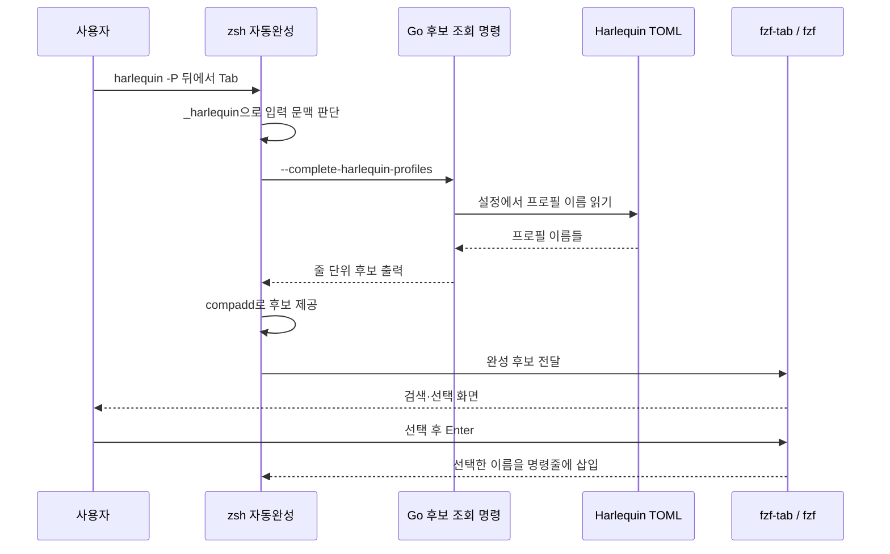

`harlequin -P ` 뒤에서 저장된 DB 프로필을 검색하고 선택하도록 자동완성을 붙였다. Zsh에서는 Tab, Fish에서는 Shift+Tab으로 fzf 선택창이 열린다. 화면은 비슷하지만 후보를 만드는 곳과 키를 처리하는 곳은 다르다.

처음에는 “fzf-tab을 설치했으니 프로필도 알아서 찾아주겠지”라고 생각했다. Fish로 옮길 때는 반대로, fzf 선택창을 연결하려면 전용 키 함수를 만들어야 한다고 생각했다. 둘 다 **후보 생성, 완성 규칙, 키 바인딩, 선택 UI를 한 기능으로 본 데서 생긴 오해**였다.

이 글은 Harlequin 설치법 대신 그 경계를 따라간다. Zsh의 완성 함수가 호출되는 원리부터 Fish의 기본 fzf 연동, 불필요한 바인딩이 기본 기능을 가렸던 원인까지 설명한다.

## 자동 제안·구문 강조·Tab 완성은 서로 다른 기능이다

“fish처럼 편하게 만든다”는 목표만으로 플러그인을 고르면 서로 다른 기능을 같은 자동완성으로 묶기 쉽다. 먼저 입력 중 어느 단계에 개입하는지 나눈다.

| 기능 | 하는 일 | Zsh에서의 구성 예 |
|---|---|---|
| 자동 제안 | 입력한 접두사에 이어질 명령을 미리 보여 줌 | zsh-autosuggestions |
| 구문 강조 | 입력 중인 명령·인자·오류 가능성을 색으로 표시 | zsh-syntax-highlighting |
| Tab 완성 | 현재 위치에 맞는 명령·옵션·인자 후보를 제공 | Zsh의 compsys |
| 후보 선택 UI | 제공된 후보를 검색하고 골라 명령줄에 삽입 | fzf-tab + fzf |

[fish는 자동 제안·구문 강조·Tab 완성을 기본 제공](https://fishshell.com/docs/current/interactive.html)한다. Zsh에도 자체 완성 시스템이 있으며, fish와 비슷한 자동 제안·구문 강조는 별도 플러그인으로 구성할 수 있다. **fzf-tab 하나가 이 기능을 모두 제공하는 것은 아니다.**

Oh My Zsh는 Zsh 자체가 아니라 설정·플러그인·테마를 관리하는 프레임워크다. 이 글의 완성 구조를 쓰는 데 필수는 아니다. 프레임워크를 쓰면 구성을 모으기 편하고, 직접 구성하면 로드할 요소를 좁힐 수 있다. 어느 쪽이 항상 빠르다는 결론보다는 실제로 로드한 설정과 플러그인을 확인해야 한다.

이하에서는 이 중 **완성 후보가 만들어지고 선택 UI에 전달되는 경로**를 Harlequin 사례로 따라간다. 일반적인 설정·키 목록은 [devkit Zsh Cheatsheet](https://github.com/clang-engineer/devkit/blob/main/reference/cheatsheets/zsh.md)와 [Fish Cheatsheet](https://github.com/clang-engineer/devkit/blob/main/reference/cheatsheets/fish.md#shift-tab-명령-문맥의-후보를-fzf로-선택)를 참고한다.

`Tab` 완성과 달리 실행했던 명령을 찾는 `Ctrl-R`은 [Atuin과 fzf의 히스토리 검색 비교](../reference/tools/2026-11-23-atuin-vs-fzf-shell-history.md)에서 다룬다. 후보 선택 화면이 비슷해도 저장할 데이터와 담당 키는 별개다.

## fzf-tab은 프로필을 모른다

[fzf-tab의 공식 설명](https://github.com/Aloxaf/fzf-tab#difference-from-other-plugins)은 명확하다. 플러그인 자체가 완성 후보를 만들어내는 것이 아니라 **기존 zsh 자동완성 시스템의 결과를 보여준다.**

이번 구현에서 역할은 다음과 같다.

| 구성 요소 | 아는 것과 맡는 일 |
|---|---|
| `harlequin-config`의 Go 코드 | Harlequin TOML의 구조를 알고 프로필 이름을 출력한다. |
| `_harlequin` zsh 함수 | 명령줄에서 `-P`의 값을 입력 중인지 판단하고 후보를 제공한다. |
| zsh 자동완성 시스템(`compsys`) | 명령에 맞는 함수를 호출하고 완성 후보를 처리한다. |
| `fzf-tab`과 `fzf` | 완성 후보를 검색·선택하는 화면을 제공한다. |

따라서 `brew "fzf-tab"`을 Brewfile에 적는 것만으로 Harlequin 프로필 자동완성이 생기지는 않는다. 그것은 **플러그인 설치 선언**이다. 프로필 후보를 제공하는 함수와 플러그인을 셸에 로드하는 설정이 별도로 필요하다.

## Tab 입력부터 명령줄 삽입까지

다음 흐름은 `harlequin -P `처럼 프로필 값을 입력하는 위치에서 Tab을 누른 경우다. Harlequin 앱은 아직 실행되지 않는다.



이 설정에서는 선택 화면의 Enter가 **명령 실행이 아니라 값 삽입**이다. 완성된 명령을 실행하려면 Enter를 한 번 더 누른다. fzf-tab에는 선택과 실행을 묶는 별도 설정도 있지만, 여기서는 사용하지 않는다.

키 입력을 어느 함수에 넘길지는 **키 바인딩**이 정한다. Zsh에서는 Tab에 연결된 완성 위젯이 완성 시스템을 호출하고, 아래의 `compdef`가 명령 이름과 완성 함수를 연결한다. `compdef` 자체가 Tab 키를 등록하는 것은 아니다. Fish의 Shift+Tab에서는 공식 fzf 연동이 그 진입점 역할을 한다.

## 명령과 자동완성 함수를 연결하는 `compdef`

zsh의 확장 자동완성 시스템은 `compinit`으로 초기화한다. 이미 프레임워크나 셸 설정이 초기화하고 있다면 중복 호출할 필요는 없다.

```zsh
autoload -Uz compinit
compinit
```

이번 도구는 다음 명령으로 함수 정의와 등록문을 출력한다.

```zsh
harlequin-config init zsh
```

그 출력에 포함된 등록문이 다음 줄이다.

```zsh
compdef _harlequin harlequin
```

뜻은 “`harlequin`의 인자를 완성할 때 `_harlequin` 함수를 사용하라”다. **프로그램 실행에 쓰는 PATH 검색과 자동완성 함수 등록은 별개**다. Harlequin 바이너리가 설치돼 있다는 사실만으로 커스텀 프로필 완성 함수가 등록되지는 않는다.

실제 `.zshrc`에서는 `compinit` 이후에 출력된 코드를 현재 셸에서 실행한다.

```zsh
eval "$(harlequin-config init zsh)"
```

여기서 외부 도구가 현재 셸을 직접 바꾸는 것은 아니다. 도구는 **코드 텍스트를 출력**하고, 현재 셸이 그 코드를 실행해 함수를 등록한다. `$(...)`와 `eval`의 차이와 신뢰 경계는 [셸 스크립트 읽기](./2026-07-03-bash-syntax-guide.md)에서 설명한다.

## `-P` 뒤라는 사실은 `_arguments`가 판단한다

프로필 이름이 필요한 위치와 파일 경로가 필요한 위치는 다르다. 바로 앞 단어 하나만 검사하면 긴 옵션, 옵션에 붙인 값, 다른 옵션의 인자를 구분하기 어려워진다. zsh의 `_arguments`는 **옵션과 인자의 형태를 선언받아 현재 완성 위치를 해석하는 도우미**다.

아래는 이번 구현의 Harlequin 완성 함수다. 프로필과 설정 경로 중심의 함수이며 Harlequin의 모든 CLI 옵션을 나열한 것은 아니다.

```zsh
_harlequin() {
  local context state state_descr line
  local -A opt_args
  _arguments -s -S \
    '(-P --profile)-P+[select a saved profile]:profile:->profiles' \
    '(-P --profile)--profile=[select a saved profile]:profile:->profiles' \
    '--config-path=[use a config file]:config file:_files' \
    '*:database:_files'

  if [[ $state == profiles ]]; then
    local -a profiles config_args
    if [[ -n ${opt_args[--config-path]} ]]; then
      config_args=("${(Q)opt_args[--config-path]}")
    fi
    profiles=("${(@f)$(harlequin-config --complete-harlequin-profiles "${config_args[@]}" 2>/dev/null)}") || return
    compadd -a profiles
  fi
}
```

핵심 선언 하나를 풀어보자.

```zsh
'(-P --profile)-P+[select a saved profile]:profile:->profiles'
```

- `(-P --profile)`은 이미 입력한 옵션에 따라 서로를 다시 제안하지 않도록 하는 제외 목록이다.
- `-P+`는 옵션 값이 `-P name`처럼 다음 단어에 오거나 `-Pname`처럼 붙을 수 있음을 선언한다.
- `[select a saved profile]`은 옵션 설명이다.
- `:profile:`은 이 옵션이 받는 인자의 표시 이름이다.
- `->profiles`는 그 인자의 완성을 호출한 함수로 돌려주면서 `state`에 `profiles` 상태를 알리는 동작이다. 셸 리다이렉션 문법이 아니다.

`--profile=`은 `--profile name`과 `--profile=name` 형태를 선언한다. `--config-path`의 값은 `_files`로 파일 완성을 제공하고, 입력된 경로는 연관 배열 `opt_args`에서 꺼내 후보 조회 명령에 전달한다. 이렇게 해야 사용자가 명시한 설정 파일의 프로필을 제안할 수 있다.

`local context state state_descr line`과 `local -A opt_args`는 `_arguments`가 상태를 전달할 변수를 해당 함수 호출 범위로 묶는다. `${(Q)...}`는 zsh의 인용 제거 플래그다. 이 코드는 Bash 공통 문법으로 읽으면 안 된다.

## stdout을 후보로 바꾸는 `compadd`

후보 조회 명령은 UI를 띄우지 않는다. 설정에서 프로필 이름만 읽고 한 줄에 하나씩 출력한다. 예를 들어 다음 TOML이 있다면:

```toml
[profiles.local_postgres]
[profiles.production]
```

조회 결과에는 `local_postgres`, `production`과 기본 프로필을 우회하는 Harlequin의 내장 선택지 `None`이 포함된다. 이름은 중복을 제거하고 정렬한다. 실제 연결 비밀번호나 DSN을 후보로 출력하지 않는다.

함수의 이 대입문은 표준 출력을 받아 배열로 바꾸는 경계다.

```zsh
profiles=("${(@f)$(harlequin-config --complete-harlequin-profiles "${config_args[@]}" 2>/dev/null)}") || return
```

`$(...)`는 명령의 표준 출력을 캡처하고, zsh의 `(@f)`는 그 출력을 줄별 배열 요소로 받는다. 공백으로 무작정 나누지 않으므로 공백이 든 프로필 이름도 하나의 후보로 다룰 수 있다. `2>/dev/null`은 완성 중 오류 메시지가 명령줄에 끼어들지 않게 한다. 후보가 나오지 않을 때는 조회 명령을 직접 실행해 오류를 확인해야 한다.

마지막 줄은 그 배열을 완성 후보로 제공한다.

```zsh
compadd -a profiles
```

`compadd`는 화면을 그리는 명령이 아니다. 현재 완성 문맥에 후보를 추가하는 zsh 내장 명령이다. fzf-tab 없이도 같은 후보를 일반 zsh 완성 UI에서 사용할 수 있는 이유가 여기에 있다.

이번 Go 구현은 명시한 `--config-path`를 환경변수 `HARLEQUIN_CONFIG_PATH`보다 우선하고, 현재 디렉터리·사용자 설정 디렉터리·홈의 후보 설정도 읽는다. `pyproject.toml`에서는 `[tool.harlequin.profiles]`를 본다. 중요한 것은 경로 목록을 외우는 것이 아니라 **Go가 설정 해석을 맡고 zsh는 그 결과를 완성 후보로 소비한다는 인터페이스**다.

## fzf-tab은 표시 계층을 바꾼다

완성 함수가 준비된 다음에 fzf-tab을 불러온다. 이 구성에서는 fzf의 셸 연동 뒤, autosuggestions와 syntax-highlighting 앞에 로드한다. 공식 문서도 `compinit` 뒤이면서 위젯을 감싸는 다른 플러그인보다 앞에 로드하도록 안내한다.

다음은 Homebrew로 fzf-tab을 설치한 뒤, 일반적인 Zsh 완성 후보에 fzf UI를 적용하는 부분이다. 앞에서 설명한 `compinit`과 Harlequin 완성 등록 이후에 둔다.

```zsh
zstyle ':completion:*' menu no
source "$(brew --prefix)/opt/fzf-tab/share/fzf-tab/fzf-tab.zsh"
```

`menu no`는 Zsh의 메뉴 완성이 먼저 개입하지 않도록 한다. Harlequin 전용 등록이 아니라 기존 완성 시스템에 붙이는 **공통 표시 계층**이므로 `cd`, Git 옵션, Harlequin 프로필 등 각 명령의 완성 후보를 같은 UI로 고를 수 있다. 후보가 하나뿐이거나 완성 결과가 없는 경우까지 항상 선택창이 뜬다는 뜻은 아니다.

따라서 Harlequin 프로필을 `harlequin-config ... | fzf`로 직접 연결하는 코드는 필요 없다. zsh 완성 후보라는 공통 접점을 쓰므로 후보 생성 코드는 UI 플러그인에 의존하지 않는다. `fzf`와 에디터 내 picker의 실행 경계는 [Telescope vs fzf](../neovim/2026-07-03-telescope-vs-fzf.md)와도 이어진다.

## 한 번 실행되는 것은 무엇인가

처음에는 설정 생성 도구이므로 한 번 실행하고 끝날 것으로 생각했다. 실제로는 같은 바이너리를 서로 다른 시점에 다른 목적으로 사용하고 있었다.

| 시점 | 실행되는 작업 | 바꾸거나 읽는 대상 |
|---|---|---|
| 소스 변경 후 `chezmoi apply` | Go 바이너리 빌드 | 설치된 실행 파일 |
| 연결 설정 생성·갱신 시 | `harlequin-config` | 생성된 Harlequin 프로필 설정 |
| 새 대화형 zsh 시작 시 | `harlequin-config init zsh` 출력 평가 | 현재 셸의 함수·완성 등록 |
| 프로필 값 위치에서 완성 요청 시 | `--complete-harlequin-profiles` | 현재 TOML의 프로필 이름 조회 |
| 완성된 명령을 실행할 때 | `harlequin -P 이름` | 선택한 프로필로 앱 실행 |

프로필 완성 경로는 DB에 접속하지 않고 설정도 재생성하지 않는다. 완성은 타이핑 중 반복해서 호출될 수 있으므로, 연결이나 파일 갱신 같은 부수 효과를 섞지 않는 경계가 중요하다. 후보 조회는 설정을 다시 읽기 때문에 생성된 TOML이 갱신되면 새 셸 없이도 다음 조회에 반영된다. 반대로 완성 **함수 코드**를 바꿨다면 현재 셸에 등록된 정의를 다시 로드해야 한다.

바이너리를 호출하는 셸 래퍼와 빌드 산출물의 관계는 [첫 셸 스크립트 만들고 실행하기](./2026-07-04-first-shell-script.md)에서 다룬다. 래퍼는 완성 후보를 저장하는 파일이 아니며, **설치·초기화·후보 조회·앱 실행을 나눠 봐야 각 파일이 필요한 이유가 드러난다.**

## 2026-11-19 보강 — fish로 옮길 때 공유되는 것과 바뀌는 것

처음 Fish로 옮길 때는 프로필 조회 프로그램과 fzf를 재사용하고, 두 도구 사이에 Harlequin 전용 Tab 함수를 작성했다. 함수가 현재 명령과 `-P` 위치를 직접 판별해 fzf를 실행하고, 다른 위치에서는 Fish 기본 완성으로 넘기는 방식이었다.

이는 당시의 구현 기록이지 Fish가 요구하는 구조가 아니다. **2026-11-25에는 공식 `fzf --fish`에 이미 범용 Shift+Tab 완성이 있다는 것을 확인하고 전용 연결부를 제거했다.** Zsh 함수와 fzf-tab을 Fish에서 그대로 읽을 수 없다는 점은 여전히 같지만, 그렇다고 선택 UI까지 직접 구현할 필요는 없었다.

현재 두 셸의 경계는 다음과 같다.

| 역할 | Zsh | Fish |
|---|---|---|
| 프로필 조회 | `harlequin-config --complete-harlequin-profiles` | 같은 실행 파일과 인자 |
| 완성 정의 | `compdef`·`_arguments`·`compadd` | `complete`와 후보 조회 함수 |
| fzf 진입점 | Tab에 연결된 fzf-tab | 공식 연동의 Shift+Tab → `fzf_complete` |
| 후보 선택·삽입 | fzf-tab과 Zsh 완성 시스템 | `fzf_complete`와 Fish의 `commandline` |

Zsh 함수는 `harlequin-config init zsh`가 출력하고 `.zshrc`가 평가한다. Fish는 `.fish` 파일을 자동 로드하는 함수·완성 디렉터리에 배포한다. **배포 방식은 달라도 후보 조회 명령은 같다.** `harlequin-config init fish` 같은 두 번째 코드 생성 경로를 만들 필요는 없다.

## 2026-11-25 보강 — Fish의 Shift+Tab은 이미 범용 fzf 완성이었다

아래 동작은 **Fish 4.9.3과 fzf 0.74.4**에서 확인했다. 모든 과거 버전에 같은 기능이 있다고 가정하면 안 된다. 근거는 [fzf 0.74.4의 공식 Fish 완성 구현](https://github.com/junegunn/fzf/blob/v0.74.4/shell/completion.fish)이다.

### `fzf --fish | source`가 키와 공통 함수를 연결한다

Fish 대화형 설정에서 다음 코드를 한 번 읽는다. 이미 초기화했다면 중복 추가하지 않는다.

```fish
if status is-interactive
    fzf --fish | source
end
```

`fzf --fish`는 Fish용 연동 코드를 출력하고, `source`가 현재 셸에서 실행한다. 그 코드에는 `fzf_complete` 함수와 다음 바인딩이 포함돼 있다.

```fish
bind shift-tab fzf_complete
```

이 연결은 Harlequin 전용이 아니다. 일반적인 명령 완성 경로에서 `fzf_complete`는 **Fish의 `complete -C`로 현재 명령줄의 후보를 얻고, fzf로 선택한 값을 `commandline`으로 삽입**한다. 명령별 후보의 의미는 Fish 완성 정의가 알고 있다. 공식 함수에는 와일드카드 확장과 사용자 정의 완성 경로도 있지만, 여기서는 일반적인 명령·인자 완성을 본다.

Harlequin 쪽에서 할 일은 후보를 Fish에 등록하는 것뿐이다.

```fish
complete -c harlequin -s P -l profile -x \
    -a '(__harlequin_profiles)' -d 'Select a saved profile'
```

이름을 조회하는 `__harlequin_profiles`는 입력된 `--config-path`를 추출해 Go 조회 명령을 호출한다. UI를 띄우거나 키를 등록하지는 않는다. `complete`가 `-P`·`--profile` 인자 완성 규칙을 제공하므로, fzf 쪽에서 Harlequin의 옵션을 다시 해석할 필요가 없다.

### 같은 Shift+Tab, 다른 후보

아래 명령줄은 **입력만 하고 Enter 대신 Shift+Tab을 누르는 예**다. 끝의 공백은 다음 인자를 완성할 위치라는 뜻이다.

| 입력 중인 명령줄 | 후보를 제공하는 곳 | 선택 후 삽입 |
|---|---|---|
| `cd ` | Fish의 디렉터리 완성 | 디렉터리 경로 |
| `kill -9 ` | Fish의 `kill` 완성 | 프로세스 PID |
| `harlequin -P ` | 등록한 Harlequin 완성과 프로필 조회 명령 | 프로필 이름 |

같은 UI에서 서로 다른 후보가 나오는 이유는 fzf가 각 프로그램을 이해해서가 아니다. **입력 문맥에 맞는 후보를 셸이 공급하기 때문**이다. 선택한 값도 프로그램의 표준입력으로 들어가지 않는다. 먼저 편집 중인 명령줄에 삽입되고, 사용자가 명령을 실행할 때 인자가 된다. `kill`의 PID를 선택하는 것만으로 프로세스가 종료되지는 않는다.

일반 Tab은 Fish 기본 완성으로 남는다. 이미 기본 완성 pager가 열린 상태에서는 `fzf_complete`도 Fish의 `complete-and-search`로 넘기므로, fzf를 열려면 pager를 닫고 명령줄에서 Shift+Tab을 누른다. 후보가 없거나 관련 완성 정의가 없을 때는 fzf도 원하는 목록을 만들어 줄 수 없다.

### 전용 바인딩이 기본 연동을 덮어썼다

처음에는 모든 Tab을 Harlequin 판별 함수로 보냈다. 이를 Shift+Tab으로 옮기면서 다음과 같은 전용 바인딩을 넣었다.

```fish
# 당시의 잘못된 연결 — 현재 설정에는 사용하지 않는다.
bind \e\[Z '__harlequin_profiles --pick'
```

사용한 터미널에서 `\e\[Z`는 Shift+Tab이었다. 이 바인딩은 기존 `fzf_complete` 연결을 덮어썼다. 전용 함수는 Harlequin 프로필 위치에서만 fzf를 실행하고, `cd`나 `kill -9`에서는 Fish 기본 완성으로 넘겼다. **fzf가 해당 명령을 지원하지 않는 게 아니라, 키가 다른 함수를 실행하고 있었던 것**이다.

해결은 분기를 더 추가하는 것이 아니었다. 전용 바인딩과 picker 코드를 제거하고, 공식 연동을 그대로 사용했다. 프로필 후보를 공급하는 함수와 `complete` 등록만 남겼다. 별도로 덮어쓰는 바인딩이 없다면 새 셸에서 공식 연결이 적용된다.

키가 예상과 다르게 동작하면 현재 소유자부터 확인한다.

```fish
bind shift-tab
# 이 구성에서 기대하는 연결: bind shift-tab fzf_complete

complete -C 'harlequin -P '
# 키·UI와 무관하게 Fish가 제공하는 프로필 후보 확인
```

후보가 없으면 완성 정의·조회 명령·설정 경로를 확인하고, 후보는 있는데 창이 다르면 키 바인딩과 초기화 순서를 확인한다. 터미널이 전달하는 키 자체가 의심되면 `fish_key_reader`로 확인한다. `Ctrl-R`을 Atuin에 맡기는 것도 같은 원리다. **같은 키에 대한 연결은 서로 독립적이지 않다.**

### reverse 배치는 어디서 오는가

검색 입력줄이 위쪽에 있는 reverse 배치는 Fish가 그리는 UI가 아니다. 확인한 버전의 `fzf_complete`가 fzf 옵션에 **`--reverse`를 포함**하기 때문이다. 따라서 직접 작성한 picker가 없어도 같은 배치가 나온다. 완성 전용 옵션은 `FZF_COMPLETION_OPTS`로 조절할 수 있으며, 자세한 옵션·키 목록은 [devkit fzf Cheatsheet](https://github.com/clang-engineer/devkit/blob/main/reference/cheatsheets/fzf.md)에 둔다.

이 사례의 개선점은 “키마다 함수를 실행하지 않도록 최적화했다”가 아니다. Zsh의 fzf-tab도 Fish의 공식 연동도 키에 연결된 함수를 실행한다. **셸이 이미 제공하는 완성 결과를 공통 UI가 소비하게 만들고, 명령별 입력 판별과 선택 동작의 중복 구현을 없앤 것**이다.

셸 코드 출력과 실행의 차이는 [문법 가이드의 초기화 설명](./2026-07-03-bash-syntax-guide.md#2026-11-19-보강--eval로-초기화-코드를-현재-셸에-읽기)으로 이어진다.


## 참고

- [zsh Completion System](https://zsh.sourceforge.io/Doc/Release/Completion-System.html): `compinit`, `compdef`, `_arguments`와 상태 전달
- [zsh Completion Widgets](https://zsh.sourceforge.io/Doc/Release/Completion-Widgets.html): `compadd`와 완성 내장 명령
- [fzf-tab 공식 README](https://github.com/Aloxaf/fzf-tab): 기존 완성 시스템과의 역할 구분·로드 순서
- [fzf-tab Configuration](https://github.com/Aloxaf/fzf-tab/wiki/Configuration): `disabled-on`, `accept-line`, 문맥별 설정
- [fzf 0.74.4 Fish 완성 소스](https://github.com/junegunn/fzf/blob/v0.74.4/shell/completion.fish): Shift+Tab 바인딩, `complete -C`, pager 예외, `--reverse`
- [Fish `complete`](https://fishshell.com/docs/current/cmds/complete.html), [`commandline`](https://fishshell.com/docs/current/cmds/commandline.html), [`bind`](https://fishshell.com/docs/current/cmds/bind.html): 후보 제공·입력 편집·키 연결
- [구현 소스 — dotfiles의 harlequin-config](https://github.com/clang-engineer/dotfiles/tree/main/tools/harlequin-config)
