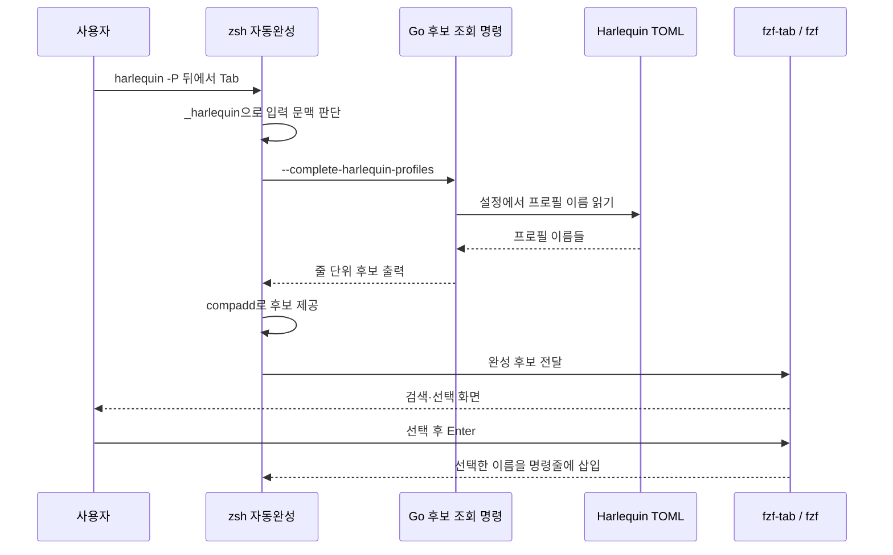

Harlequin에서 `harlequin -P ` 뒤에 Tab을 누르면 저장된 DB 프로필을 검색하고 선택하게 만들었다. 처음에는 “fzf-tab을 설치했으니 fzf-tab이 프로필을 찾아주는 것”처럼 보였다. 그런데 설정 파일을 읽는 Go 코드도 있고, zsh 함수도 있고, 별도 실행 래퍼까지 있었다.

이 구성을 이해하는 열쇠는 **후보를 아는 프로그램, 입력 위치를 아는 셸, 후보를 보여주는 UI가 서로 다르다**는 점이다. 이 글은 Harlequin 설치법 대신, 하나의 Tab 입력이 그 경계를 어떻게 통과하는지 설명한다.

## 자동 제안·구문 강조·Tab 완성은 서로 다른 기능이다

“fish처럼 편하게 만든다”는 목표만으로 플러그인을 고르면 서로 다른 기능을 같은 자동완성으로 묶기 쉽다. 먼저 입력 중 어느 단계에 개입하는지 나눈다.

| 기능 | 하는 일 | Zsh에서의 구성 예 |
|---|---|---|
| 자동 제안 | 입력한 접두사에 이어질 명령을 미리 보여 줌 | zsh-autosuggestions |
| 구문 강조 | 입력 중인 명령·인자·오류 가능성을 색으로 표시 | zsh-syntax-highlighting |
| Tab 완성 | 현재 위치에 맞는 명령·옵션·인자 후보를 제공 | Zsh의 compsys |
| 후보 선택 UI | 제공된 후보를 검색하고 골라 명령줄에 삽입 | fzf-tab + fzf |

[fish는 자동 제안·구문 강조·Tab 완성을 기본 제공](https://fishshell.com/docs/current/interactive.html)한다. Zsh에도 자체 완성 시스템이 있으며, fish와 비슷한 자동 제안·구문 강조는 별도 플러그인으로 구성할 수 있다. **fzf-tab 하나가 이 기능을 모두 제공하는 것은 아니다.**

Oh My Zsh는 Zsh 자체가 아니라 설정·플러그인·테마를 관리하는 프레임워크다. 이 글의 완성 구조를 쓰는 데 필수는 아니다. 프레임워크를 쓰면 구성을 모으기 편하고, 직접 구성하면 로드할 요소를 좁힐 수 있다. 어느 쪽이 항상 빠르다는 결론보다는 실제로 로드한 설정과 플러그인을 확인해야 한다.

이하에서는 이 중 **Tab 완성 후보가 만들어지고 선택 UI에 전달되는 경로**를 Harlequin 사례로 따라간다. 일반적인 Zsh 설정 명령은 [devkit Zsh Cheatsheet](https://github.com/clang-engineer/devkit/blob/main/reference/cheatsheets/zsh.md)를 참고한다.

`Tab` 완성과 달리 실행했던 명령을 찾는 `Ctrl-R`은 [Atuin과 fzf의 히스토리 검색 비교](../reference/tools/2026-11-23-atuin-vs-fzf-shell-history.md)에서 다룬다. 후보 선택 화면이 비슷해도 저장할 데이터와 담당 키는 별개다.

## fzf-tab은 프로필을 모른다

[fzf-tab의 공식 설명](https://github.com/Aloxaf/fzf-tab#difference-from-other-plugins)은 명확하다. 플러그인 자체가 완성 후보를 만들어내는 것이 아니라 **기존 zsh 자동완성 시스템의 결과를 보여준다.**

이번 구현에서 역할은 다음과 같다.

| 구성 요소 | 아는 것과 맡는 일 |
|---|---|
| `harlequin-config`의 Go 코드 | Harlequin TOML의 구조를 알고 프로필 이름을 출력한다. |
| `_harlequin` zsh 함수 | 명령줄에서 `-P`의 값을 입력 중인지 판단하고 후보를 제공한다. |
| zsh 자동완성 시스템(`compsys`) | 명령에 맞는 함수를 호출하고 완성 후보를 처리한다. |
| `fzf-tab`과 `fzf` | 완성 후보를 검색·선택하는 화면을 제공한다. |

따라서 `brew "fzf-tab"`을 Brewfile에 적는 것만으로 Harlequin 프로필 자동완성이 생기지는 않는다. 그것은 **플러그인 설치 선언**이다. 프로필 후보를 제공하는 함수와 플러그인을 셸에 로드하는 설정이 별도로 필요하다.

## Tab 입력부터 명령줄 삽입까지

다음 흐름은 `harlequin -P `처럼 프로필 값을 입력하는 위치에서 Tab을 누른 경우다. Harlequin 앱은 아직 실행되지 않는다.



이 설정에서는 선택 화면의 Enter가 **명령 실행이 아니라 값 삽입**이다. 완성된 명령을 실행하려면 Enter를 한 번 더 누른다. fzf-tab에는 선택과 실행을 묶는 별도 설정도 있지만, 여기서는 사용하지 않는다.

## 명령과 자동완성 함수를 연결하는 `compdef`

zsh의 확장 자동완성 시스템은 `compinit`으로 초기화한다. 이미 프레임워크나 셸 설정이 초기화하고 있다면 중복 호출할 필요는 없다.

```zsh
autoload -Uz compinit
compinit
```

이번 도구는 다음 명령으로 함수 정의와 등록문을 출력한다.

```zsh
harlequin-config init zsh
```

그 출력에 포함된 등록문이 다음 줄이다.

```zsh
compdef _harlequin harlequin
```

뜻은 “`harlequin`의 인자를 완성할 때 `_harlequin` 함수를 사용하라”다. **프로그램 실행에 쓰는 PATH 검색과 자동완성 함수 등록은 별개**다. Harlequin 바이너리가 설치돼 있다는 사실만으로 커스텀 프로필 완성 함수가 등록되지는 않는다.

실제 `.zshrc`에서는 `compinit` 이후에 출력된 코드를 현재 셸에서 실행한다.

```zsh
eval "$(harlequin-config init zsh)"
```

여기서 외부 도구가 현재 셸을 직접 바꾸는 것은 아니다. 도구는 **코드 텍스트를 출력**하고, 현재 셸이 그 코드를 실행해 함수를 등록한다. `$(...)`와 `eval`의 차이와 신뢰 경계는 [셸 스크립트 읽기](./2026-07-03-bash-syntax-guide.md)에서 설명한다.

## `-P` 뒤라는 사실은 `_arguments`가 판단한다

프로필 이름이 필요한 위치와 파일 경로가 필요한 위치는 다르다. 바로 앞 단어 하나만 검사하면 긴 옵션, 옵션에 붙인 값, 다른 옵션의 인자를 구분하기 어려워진다. zsh의 `_arguments`는 **옵션과 인자의 형태를 선언받아 현재 완성 위치를 해석하는 도우미**다.

아래는 이번 구현의 Harlequin 완성 함수다. 프로필과 설정 경로 중심의 함수이며 Harlequin의 모든 CLI 옵션을 나열한 것은 아니다.

```zsh
_harlequin() {
  local context state state_descr line
  local -A opt_args
  _arguments -s -S \
    '(-P --profile)-P+[select a saved profile]:profile:->profiles' \
    '(-P --profile)--profile=[select a saved profile]:profile:->profiles' \
    '--config-path=[use a config file]:config file:_files' \
    '*:database:_files'

  if [[ $state == profiles ]]; then
    local -a profiles config_args
    if [[ -n ${opt_args[--config-path]} ]]; then
      config_args=("${(Q)opt_args[--config-path]}")
    fi
    profiles=("${(@f)$(harlequin-config --complete-harlequin-profiles "${config_args[@]}" 2>/dev/null)}") || return
    compadd -a profiles
  fi
}
```

핵심 선언 하나를 풀어보자.

```zsh
'(-P --profile)-P+[select a saved profile]:profile:->profiles'
```

- `(-P --profile)`은 이미 입력한 옵션에 따라 서로를 다시 제안하지 않도록 하는 제외 목록이다.
- `-P+`는 옵션 값이 `-P name`처럼 다음 단어에 오거나 `-Pname`처럼 붙을 수 있음을 선언한다.
- `[select a saved profile]`은 옵션 설명이다.
- `:profile:`은 이 옵션이 받는 인자의 표시 이름이다.
- `->profiles`는 그 인자의 완성을 호출한 함수로 돌려주면서 `state`에 `profiles` 상태를 알리는 동작이다. 셸 리다이렉션 문법이 아니다.

`--profile=`은 `--profile name`과 `--profile=name` 형태를 선언한다. `--config-path`의 값은 `_files`로 파일 완성을 제공하고, 입력된 경로는 연관 배열 `opt_args`에서 꺼내 후보 조회 명령에 전달한다. 이렇게 해야 사용자가 명시한 설정 파일의 프로필을 제안할 수 있다.

`local context state state_descr line`과 `local -A opt_args`는 `_arguments`가 상태를 전달할 변수를 해당 함수 호출 범위로 묶는다. `${(Q)...}`는 zsh의 인용 제거 플래그다. 이 코드는 Bash 공통 문법으로 읽으면 안 된다.

## stdout을 후보로 바꾸는 `compadd`

후보 조회 명령은 UI를 띄우지 않는다. 설정에서 프로필 이름만 읽고 한 줄에 하나씩 출력한다. 예를 들어 다음 TOML이 있다면:

```toml
[profiles.local_postgres]
[profiles.production]
```

조회 결과에는 `local_postgres`, `production`과 기본 프로필을 우회하는 Harlequin의 내장 선택지 `None`이 포함된다. 이름은 중복을 제거하고 정렬한다. 실제 연결 비밀번호나 DSN을 후보로 출력하지 않는다.

함수의 이 대입문은 표준 출력을 받아 배열로 바꾸는 경계다.

```zsh
profiles=("${(@f)$(harlequin-config --complete-harlequin-profiles "${config_args[@]}" 2>/dev/null)}") || return
```

`$(...)`는 명령의 표준 출력을 캡처하고, zsh의 `(@f)`는 그 출력을 줄별 배열 요소로 받는다. 공백으로 무작정 나누지 않으므로 공백이 든 프로필 이름도 하나의 후보로 다룰 수 있다. `2>/dev/null`은 완성 중 오류 메시지가 명령줄에 끼어들지 않게 한다. 후보가 나오지 않을 때는 조회 명령을 직접 실행해 오류를 확인해야 한다.

마지막 줄은 그 배열을 완성 후보로 제공한다.

```zsh
compadd -a profiles
```

`compadd`는 화면을 그리는 명령이 아니다. 현재 완성 문맥에 후보를 추가하는 zsh 내장 명령이다. fzf-tab 없이도 같은 후보를 일반 zsh 완성 UI에서 사용할 수 있는 이유가 여기에 있다.

이번 Go 구현은 명시한 `--config-path`를 환경변수 `HARLEQUIN_CONFIG_PATH`보다 우선하고, 현재 디렉터리·사용자 설정 디렉터리·홈의 후보 설정도 읽는다. `pyproject.toml`에서는 `[tool.harlequin.profiles]`를 본다. 중요한 것은 경로 목록을 외우는 것이 아니라 **Go가 설정 해석을 맡고 zsh는 그 결과를 완성 후보로 소비한다는 인터페이스**다.

## fzf-tab은 표시 계층을 바꾼다

완성 함수가 준비된 다음에 fzf-tab을 불러온다. 이 구성에서는 fzf의 셸 연동 뒤, autosuggestions와 syntax-highlighting 앞에 로드한다. 공식 문서도 `compinit` 뒤이면서 위젯을 감싸는 다른 플러그인보다 앞에 로드하도록 안내한다.

다음은 fzf-tab이 설치되어 있다는 전제에서, 표시 계층을 Harlequin에만 적용하는 설정이다.

```zsh
zstyle ':fzf-tab:*' disabled-on any
zstyle ':fzf-tab:complete:harlequin:*' disabled-on none
zstyle ':completion:*:harlequin:*' menu no
source "$(brew --prefix)/opt/fzf-tab/share/fzf-tab/fzf-tab.zsh"
```

첫 줄로 전체 비활성화하고, 더 구체적인 Harlequin 문맥에서만 활성화한다. `menu no`는 zsh의 메뉴 완성이 먼저 개입하지 않도록 한다. 이 설정은 **Harlequin 명령의 완성 UI**에 적용되는 것이지 `-P` 한 자리만 대상으로 하는 것은 아니다.

따라서 Harlequin 프로필을 `harlequin-config ... | fzf`로 직접 연결하는 코드는 필요 없다. zsh 완성 후보라는 공통 접점을 쓰므로 후보 생성 코드는 UI 플러그인에 의존하지 않는다. `fzf`와 에디터 내 picker의 실행 경계는 [Telescope vs fzf](../neovim/2026-07-03-telescope-vs-fzf.md)와도 이어진다.

## 한 번 실행되는 것은 무엇인가

처음에는 설정 생성 도구이므로 한 번 실행하고 끝날 것으로 생각했다. 실제로는 같은 바이너리를 서로 다른 시점에 다른 목적으로 사용하고 있었다.

| 시점 | 실행되는 작업 | 바꾸거나 읽는 대상 |
|---|---|---|
| 소스 변경 후 `chezmoi apply` | Go 바이너리 빌드 | 설치된 실행 파일 |
| 연결 설정 생성·갱신 시 | `harlequin-config` | 생성된 Harlequin 프로필 설정 |
| 새 대화형 zsh 시작 시 | `harlequin-config init zsh` 출력 평가 | 현재 셸의 함수·완성 등록 |
| 프로필 값 위치에서 완성 요청 시 | `--complete-harlequin-profiles` | 현재 TOML의 프로필 이름 조회 |
| 완성된 명령을 실행할 때 | `harlequin -P 이름` | 선택한 프로필로 앱 실행 |

프로필 완성 경로는 DB에 접속하지 않고 설정도 재생성하지 않는다. 완성은 타이핑 중 반복해서 호출될 수 있으므로, 연결이나 파일 갱신 같은 부수 효과를 섞지 않는 경계가 중요하다. 후보 조회는 설정을 다시 읽기 때문에 생성된 TOML이 갱신되면 새 셸 없이도 다음 조회에 반영된다. 반대로 완성 **함수 코드**를 바꿨다면 현재 셸에 등록된 정의를 다시 로드해야 한다.

바이너리를 호출하는 셸 래퍼와 빌드 산출물의 관계는 [첫 셸 스크립트 만들고 실행하기](./2026-07-04-first-shell-script.md)에서 다룬다. 래퍼는 완성 후보를 저장하는 파일이 아니며, **설치·초기화·후보 조회·앱 실행을 나눠 봐야 각 파일이 필요한 이유가 드러난다.**

## 2026-11-19 보강 — fish로 옮길 때 공유되는 것과 바뀌는 것

같은 Harlequin 완성을 fish로 옮기면서 경계가 더 분명해졌다. **프로필을 조회하는 Go 프로그램과 검색 UI인 fzf는 재사용할 수 있지만, Zsh 완성 함수와 fzf-tab은 그대로 로드할 수 없다.** 셸 문법뿐 아니라 후보 제공과 명령줄 편집 인터페이스가 다르기 때문이다.

| 역할 | Zsh 구성 | 이번 fish 구성 |
|---|---|---|
| 프로필 조회 | `harlequin-config --complete-harlequin-profiles` | 같은 실행 파일과 인자 |
| 완성 정의 | `compdef`·`_arguments`·`compadd` | fish의 `complete`와 후보 조회 함수 |
| 검색 UI 연결 | 범용 플러그인 fzf-tab | Harlequin 프로필 위치에 한정한 함수 |
| 명령줄 편집 | Zsh 완성 시스템과 fzf-tab | fish의 `commandline` |

fish에서는 `completions/harlequin.fish`에 완성을 정의하고, `functions/` 아래 함수에서 후보 조회와 Tab 선택 동작을 연결했다. Tab 함수는 프로필 입력 위치일 때만 fish의 완성 결과를 fzf에 넘기고, 선택값을 현재 토큰에 삽입한다. 그 외에는 fish 기본 완성을 호출한다. 그래서 `git` 뒤에서 보이는 설명 달린 후보 목록은 fzf-tab이 아니라 **fish 기본 완성 UI**다.

선택 결과는 Harlequin의 표준입력으로 들어가는 것이 아니다. 먼저 셸이 편집 중인 명령줄에 삽입되고, 사용자가 다시 Enter를 눌러 실행할 때 `-P`의 인자로 전달된다.

Zsh에도 같은 전용 함수를 만들 수 있었지만, 이미 fzf-tab이 범용 연결을 제공했으므로 중복 구현하지 않았다. fish에서는 기존 선택 동작을 보존하려고 작은 전용 연결부를 작성했다. 이는 fish에 플러그인 생태계가 없어서가 아니며, 모든 명령에 적용하는 범용 fzf 완성을 새로 구현한 것도 아니다.

### 설치·초기화·후보 조회는 여전히 별개다

이 사례에서 Zsh 함수는 Go의 `initZsh()`가 반환하는 문자열에 담겨 있다. `harlequin-config init zsh`가 이를 출력하고 `.zshrc`의 `eval`이 현재 셸에 등록한다. fish 쪽은 `.fish` 파일로 배포하므로 `harlequin-config init fish`를 구현할 필요가 없었다. 두 방식 모두 같은 후보 조회 명령을 호출한다.

Zsh에서 fzf-tab을 Harlequin에만 켠 것도 기술적 제약이 아니라 다른 명령의 기존 UI를 보존하려는 선택이다. 문맥별 제한을 해제하면 Git이나 파일 완성에도 사용할 수 있다. Atuin의 Ctrl+R과 fzf-tab의 Tab은 담당 키가 다르지만, 같은 키나 ZLE 위젯을 바꾸는 플러그인은 로드 순서와 실제 바인딩을 확인해야 한다. **후보 제공과 화면 표시를 분리하면 이 선택을 Go 조회 코드와 독립적으로 바꿀 수 있다.**

fish 측 인터페이스는 공식 [`complete`](https://fishshell.com/docs/current/cmds/complete.html), [`commandline`](https://fishshell.com/docs/current/cmds/commandline.html), [`bind`](https://fishshell.com/docs/current/cmds/bind.html) 문서에서 확인할 수 있다. 셸 코드 출력과 실행의 차이는 [문법 가이드의 초기화 설명](./2026-07-03-bash-syntax-guide.md#2026-11-19-보강--eval로-초기화-코드를-현재-셸에-읽기)으로 이어진다.


## 참고

- [zsh Completion System](https://zsh.sourceforge.io/Doc/Release/Completion-System.html): `compinit`, `compdef`, `_arguments`와 상태 전달
- [zsh Completion Widgets](https://zsh.sourceforge.io/Doc/Release/Completion-Widgets.html): `compadd`와 완성 내장 명령
- [fzf-tab 공식 README](https://github.com/Aloxaf/fzf-tab): 기존 완성 시스템과의 역할 구분·로드 순서
- [fzf-tab Configuration](https://github.com/Aloxaf/fzf-tab/wiki/Configuration): `disabled-on`, `accept-line`, 문맥별 설정
- [구현 소스 — dotfiles의 harlequin-config](https://github.com/clang-engineer/dotfiles/tree/main/tools/harlequin-config)
